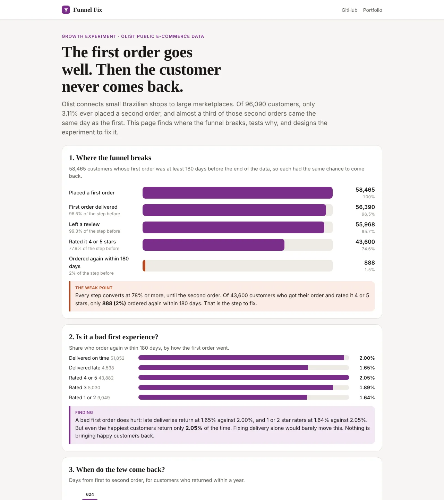

# Funnel Fix

**Olist wins the first order and then loses the customer: 2% of happy first-time buyers order again. Where the funnel breaks, why, and an experiment designed to fix it, with a sample size and cost calculator.**

**Current version:** 0.1.0

Live: https://kostasxeras.com/funnel-fix/



## The question

A marketplace can grow by finding new buyers or by bringing existing ones back. Olist's public data shows the second is almost not happening. Which step of the customer funnel is weakest, what explains it, and what experiment would fix it?

## Who it is for

- Growth and lifecycle product managers
- CRM and retention marketers designing win-back programs
- Hiring managers reading this as an example of going from data to a testable experiment

## What is inside

- **Funnel:** first order, delivered, reviewed, rated 4 or 5, ordered again within 180 days, for customers with equal time to return.
- **Diagnosis:** return rate by delivery outcome, rating and first-order category, and when returning customers come back.
- **Experiment design:** hypothesis, eligibility, randomisation, control and treatment, primary, secondary and guardrail metrics, decision rule, and a two-phase plan (reminder first, free shipping only if the reminder works).
- **Calculator:** sample size for any baseline, lift, power and split, run time from monthly traffic, and the free-shipping cost per extra order with the break-even margin.
- **Risks:** who owns the customer on a marketplace, small numbers, timing and cannibalisation, each with a mitigation.

## Main findings

Full detail in the [case study](docs/case-study.md).

- **The second order is the broken step** (confirmed). Every step from first order to a 4 or 5 star rating converts at 78% or more. Of 43,600 happy first-time customers, 888 (2.0%) ordered again within 180 days.
- **Same-day second orders are not returns** (confirmed). 30% of second orders were placed on the same day as the first, so they are split baskets. Counting them would overstate retention.
- **A bad first order hurts, but is not the main cause** (confirmed). Late first orders return at 1.65% against 2.00% on time. 1 and 2 star raters at 1.64% against 2.05%. Even the happiest customers rarely come back.
- **Returning customers come back early** (confirmed). Median 68 days, a quarter within 22 days, and the first month is the busiest.
- **Home and sports purchases bring people back most** (confirmed). Bed and bath 2.66%, sports 2.61%, furniture and decor 2.42%, against 1.51% for computer accessories.
- **Free shipping needs a high margin to pay** (estimate). At a 1.37% baseline and a 50% lift, free shipping (median freight 17.19 BRL) costs 51 BRL per extra second order, against a median order of 86.57 BRL, so it needs about a 59% margin. Hence a cheap reminder first.
- **A day-21 reminder lifts 90-day repeat orders by 50% or more** (hypothesis). The experiment exists to test this. Needs about 11,300 customers and 5.4 months at 4,765 eligible customers a month.

## Data and sources

[Olist public e-commerce dataset](https://github.com/olist/work-at-olist-data), MIT licence. Customers are matched by Olist's unique customer ID. Orders after August 2018 (a handful) are left out. Olist is not involved in this project.

## Decisions

- [Do not count same-day second orders as a return](docs/decisions/0001-exclude-same-day-orders.md)
- [Test a free reminder before a free-shipping voucher](docs/decisions/0002-reminder-before-voucher.md)
- [Size the test for a 50% lift, and say why](docs/decisions/0003-target-a-large-lift.md)

## How I would measure success

These are the experiment's own metrics. Nothing has run yet.

| Measure | Definition | Target |
|---|---|---|
| 90-day repeat rate | Second order on a later day within 90 days, eligible customers | 1.37% today, target 2.06% or more |
| Unsubscribe and complaint rate | Guardrail on the message | Below [x]% |
| Contribution per treated customer | Guardrail in phase 2 | Not negative |

## What I would do next

1. Run phase 1 with a parcel insert if the marketplace owns the email address
2. Test the timing: day 7, 21 and 45
3. Model which first orders predict a return, to target the message

## My role

I framed the problem, made the product calls and wrote the conclusions. 

## Run it yourself

Open `index.html` through any local web server. Rebuild the numbers: `sh scripts/0-download.sh`, then `python3 scripts/analyze.py` (pandas).

## Repo layout

```
index.html               The page
data/funnel.json         Every number on the page
scripts/0-download.sh    Downloads the Olist CSVs
scripts/analyze.py       Funnel, segments, timing, baseline
docs/                    Case study, brief, decisions, output, screenshots
```
